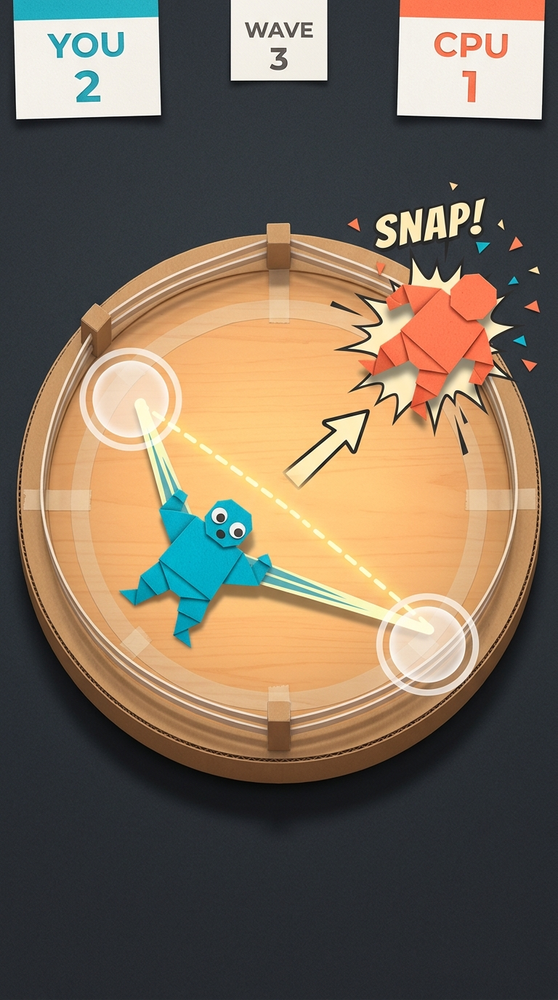

# Pinch & Fold

A tactile, two-finger elastic physics wrestling game for Android built in pure Kotlin (`SurfaceView` + `Canvas` + `SoundPool` + `VibrationEffect`) with zero third-party game engine dependencies.

  

## Mechanics
- **2-Finger Elastic Snap:** Place two fingers to anchor your origami wrestler's arms, pull apart to build tension, and lift one finger to whip-launch toward the remaining anchor.
- **Pinch Grapple:** Pinch two fingers inward over an opponent to grab and fling them.
- **1-Finger Fallback:** Single-finger drag-and-release slingshot for one-handed play.
- **Deforming Rubber-Band Ropes & Ring-Outs:** Moderate hits rebound off the elastic ring ropes; heavy or stunned slams break through for a **RING OUT!**

## Game Modes
- **Solo Waves:** Escalating CPU paper-craft archetypes (*Flimsy*, *Brute*, *Dart*, and *Champ* boss waves).
- **2P Same Phone:** Simultaneous 4-finger tabletop 1v1 on a single device (first to 5).

## Tech Stack
- **Language:** Kotlin (Android SDK `minSdk 24` / `targetSdk 34`)
- **Rendering:** Custom 60fps `SurfaceView` / `Canvas` renderer with squash-and-stretch, hit-stop micro-freeze, screen shake, paper confetti, and comic starburst popups
- **Audio & Haptics:** 7 custom synthesized `.wav` sound effects via `SoundPool` + `VibrationEffect` tactile feedback

## Build & Run
1. Open this folder in **Android Studio**.
2. Let Gradle sync (`compileSdk = 34`, JDK 17).
3. Run on an Android device or emulator.
